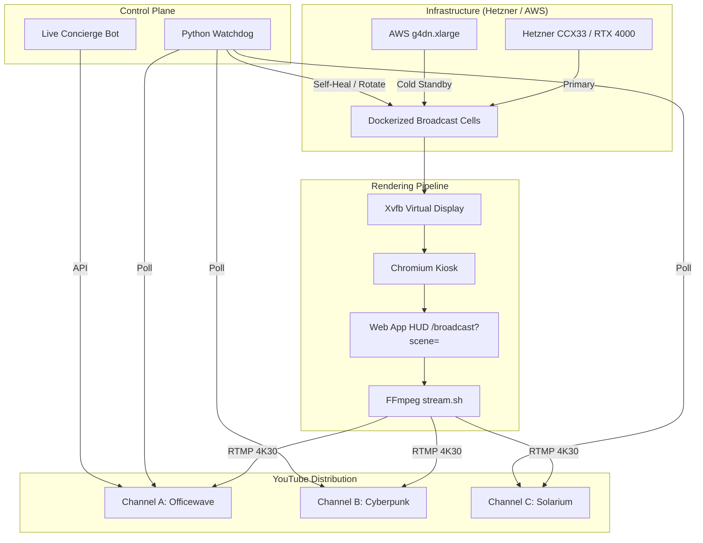

# Dependency Maps and System Topology

## High-Level Topology

## Core Dependencies
- **OS/Containerization:** Docker, Docker Compose
- **Graphics/Display:** Xvfb, Chromium (Kiosk Mode)
- **Encoding:** FFmpeg (NVENC hardware acceleration)
- **Audio:** 320 kbps AAC stem generators
- **Automation:** Python (Watchdog, YouTube Data API v3, Live Chat API)
